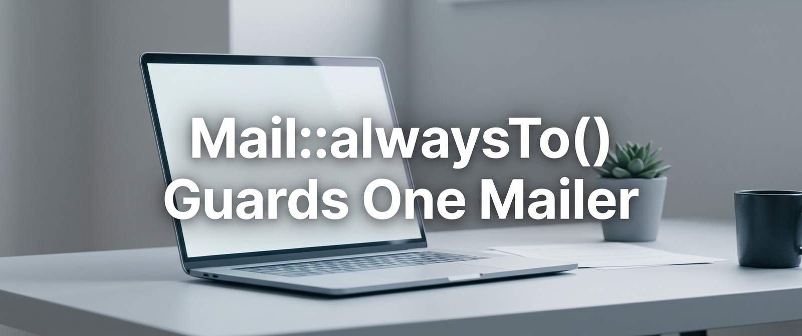

# Mail::alwaysTo() Guards One Mailer: The Staging Leak It Leaves Open

I was about to add `Mail::alwaysTo()` to our staging setup, the same tip you find in the Laravel docs and on half a dozen blogs. Before shipping it, I checked what the facade actually does with that call.

Turns out, it redirects only the default mailer. `Mail::mailer('billing')` and a notification with its own mailer still go to the real recipient.

## What's Inside

- A sandbox repro: default mailer redirected, second mailer sends to the real address
- Why: `MailManager::__call` forwards to the default mailer only, and named mailers read their global `to` from config
- The second failure under Octane, confirmed by a Laravel maintainer
- The fix: `mail.to` in config, set from `.env` on staging only, plus a boot guard so it cannot fail open
- A test that walks every configured mailer and fails when one escapes the redirect

## 📎 Read Full

[Mail::alwaysTo() Guards One Mailer: The Staging Leak It Leaves Open](https://dev.to/tegos/PLACEHOLDER)
